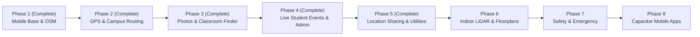

# Project Roadmap: LPU Smart Campus Navigator

This roadmap outlines the phased development trajectory for the LPU Smart Campus Navigator. Phase 1 provides the core mobile-first foundation, verified dataset architecture, and GPS mechanics.

---

---

## 📍 Phase 1: Foundation, GIS Data & Mobile UX (Complete)
- [x] Full mobile viewport integration (`100dvh`, notch & bottom bar safe areas).
- [x] Interactive OpenStreetMap integration with LPU bounds (`31.25492, 75.70462`).
- [x] Typed campus GIS dataset covering Academic blocks, Hostels, UniMall, Library, Food, Medical, Sports, Gates.
- [x] Verification status segregation (`verified_osm`, `approximate_osm`, `pending_survey`).
- [x] Floating search bar with auto-suggestions, token search, and category pills.
- [x] Google Maps-inspired draggable bottom sheet with action controls.
- [x] High-precision GPS tracking with accuracy circle, heading cone, and follow mode.
- [x] Mobile compass control with heading orientation.
- [x] Local bookmarking (Saved places) and recent searches.
- [x] PWA manifest and mobile icon set.

---

## 🚶 Phase 2: Real GPS & Campus Navigation (Complete)
- [x] Verified campus path network graph (`src/data/campusRouteGraph.ts`) with 30 nodes and 56 edges.
- [x] Client-side Dijkstra routing engine with strict mode-specific pathway filtering.
- [x] **Walking Mode**: Navigates pedestrian boulevards, corridors, plazas, and pathways.
- [x] **Bike Mode**: Routes along wide paved avenues and perimeter cycle rings.
- [x] **Car Mode**: Restricted to peripheral vehicular roads; auto-routes to nearest parking lot when destination is in pedestrian core.
- [x] **Wheelchair Mode**: Strictly checks verified grade-level ramps and level concourses; reports unavailable when entrance plinths have physical stairs.
- [x] Dynamic turn-by-turn navigation instructions ("Head north on Central Academic Boulevard", "Turn right onto UniMall Walkway").
- [x] Navigation Top Turn Card (`NavigationTurnCard`) and Bottom Dashboard (`NavigationBottomBar`).
- [x] Real-time speedometer (km/h) and dynamic ETA based on speed.
- [x] Turn-by-turn itinerary modal (`NavigationStepsModal`).
- [x] Live GPS auto-following camera tracking during navigation with recenter toggle.
- [x] Weak GPS signal detection (accuracy > 50m) and stale coordinate warnings.

---

## 🏫 Phase 3: Building Photos & Classroom Finder (Complete)
- [x] **Verified Building Photography**:
  - Main Gate 1 authentic highway entrance photograph integrated with attribution metadata (Wikimedia Commons CC BY-SA 4.0).
  - Strict anti-stock policy: No random or unrelated stock photos.
  - Polished "Photo Pending" UI for buildings awaiting verified on-ground field survey.
  - Reusable `CampusImageMetadata` data model ready for admin uploads and Firebase storage.
- [x] **Classroom Finder**:
  - Intelligent parser supporting `{Block}-{RoomNumber}` patterns (e.g., `34-405`, `36-201`, `38-101`, `25-101`, `LIB-101`).
  - Automatic floor inference (e.g. `34-405` -> Block 34, 4th Floor).
  - Navigation links directly to the verified ground entrance of the parent building.
  - Factual indoor guidance notes without fabricating unverified floorplans.
- [x] **Smart Campus Search**:
  - Multi-category search supporting building numbers ("34", "36"), classroom numbers ("34-405"), hostels ("BH-1", "GH-2"), departments ("CSE", "Mechanical", "MBA"), facilities ("ATM", "Gym", "Hospital"), and aliases.
  - Visual suggestion tags (`Classroom · Floor 4`, `Block 34`, `Hostel`).
- [x] **Building Information Bottom Sheet**:
  - Verified infrastructure grid (Total floors, operational elevators, restrooms, RO drinking water).
  - Hosted departments and schools tags.
  - Verified features chips and step-free accessibility details.
- [x] **Navigation Accuracy Audit & Improvements**:
  - Off-campus origin GPS snapping to Main Gate 1 with advisory notice.
  - Dynamic off-route recalculation when student drifts > 45 meters during active navigation.
  - Accurate path-geometry remaining distance and ETA calculation.
  - Wheelchair safety ramp enforcement.

---

## 🎪 Phase 4: Live Campus Events & Admin Panel (Complete)
- [x] Real-time campus event sharing system at mapped locations (UniPolis, UniMall, auditoriums, sports grounds, academic blocks).
- [x] 7 categorized Leaflet DivIcon markers (`concert`, `party`, `cultural`, `workshop`, `sports`, `activity`, `other`).
- [x] Prominent visual pulsing ripple effect and "LIVE" badges for running events.
- [x] Student event submission modal collecting Legal Name, Course, Year of Study, Title, Category, Location, and Timings.
- [x] **Strict 6-Hour Duration Enforcement**: Validates and rejects any event with duration > 6 hours (`maxDurationMinutes: 360`) or past end times.
- [x] **Privacy-Preserving Security Boundary**:
  - Public `events` collection shows *only* creator's display name (`Added by Rahul`).
  - Sensitive academic registration details (Legal Name, Course, Year) stored in restricted `event_private_metadata`.
  - Production `firestore.rules` verifying duration, author mutations, public read access, and zero data leakage.
- [x] **Dual-Mode Real-Time Synchronization**: Live Firebase Firestore (`onSnapshot`) with offline-resilient `BroadcastChannel` and `localStorage` fallback.
- [x] Automated 15-second client-side ticker transitioning events through `upcoming` $\rightarrow$ `live` $\rightarrow$ `ended`.
- [x] Google Maps-style Event Details Card (`EventDetailsSheet`) with 1-tap Directions, Share, and Abuse Report.
- [x] **Secure University Admin Dashboard & Dedicated `/admin` Route**:
  - Dedicated `/admin` route with desktop sidebar and responsive mobile layout.
  - Google Maps-style navigation menu drawer in search bar with admin entry point.
  - Role-based Firebase Authentication with custom claim `{ admin: true }` and `/admin_users/{uid}` verification (no hardcoded passwords).
  - Admin provisioning script (`scripts/setAdmin.cjs`) for university staff authorization.
  - KPI analytics, full student academic identity audit log (Legal Name, Course, Year, UID), road closures, abuse reports, and single-click event removal.
- [x] Community abuse reporting system with structured violation categories and duplicate detection.

---

## 🤝 Phase 5: Smart Location Sharing & Campus Utilities (Complete)
- [x] **WhatsApp Live Location Sharing**:
  - Secure unguessable capability URL generation (`?share=lpu_loc_...`).
  - 15 minutes, 1 hour, or 8 hours duration options with auto-expiration.
  - Live GPS moving tracking vs one-time location pin toggle.
  - 1-tap WhatsApp sharing link (`wa.me`) and Web Share API.
  - Active broadcasting banner with real-time countdown ticker and instant "Stop Sharing" button.
  - Honest browser background GPS advisory notice.
- [x] **Meet My Friend**:
  - Deep-link receiver with live Firestore `onSnapshot` and multi-tab `BroadcastChannel` synchronization.
  - Leaflet friend marker with avatar circle, green radar ping, and accuracy halo.
  - Dynamic moving target navigation: automatically recalculates destination and path as the friend moves.
  - Integrated with all 4 modes (Walking, Bike, Car, Wheelchair).
- [x] **Offline Campus Map**:
  - 100% client-side local search across all campus blocks, hostels, and classrooms.
  - Verified routing graph and Dijkstra pathfinding run completely offline without internet.
  - Device GPS works offline via hardware satellites on mobile.
  - Real-time online/offline indicator banner.
  - Full adherence to OpenStreetMap tile usage and scraping policies.
- [x] **QR Campus Navigation**:
  - Physical entrance QR codes (`?qr=<locationId>`) setting origin to verified entrance.
  - Strict security validation rejecting unverified or arbitrary GPS coordinates.
  - Instant navigation prompt to popular campus destinations.
  - Admin-only QR Code Generator producing printable SVG badges for all 28+ verified buildings.
- [x] **Road Closure Alerts & Dynamic Recalculation**:
  - Synchronized path closures rendered with striped red/amber warning polylines and barrier markers.
  - Dijkstra router automatically bypasses closed segments and plots optimal detours.
  - Admin management console to create and expire closures.
  - Student blockage reporting modal with administrative moderation queue.
- [x] **Emergency Assistance (SOS)**:
  - Floating high-visibility red SOS trigger.
  - Verified university contacts: Main Security (`01824-517000`), UniHospital (`01824-517100`), Campus Ambulance (`01824-517101`), Women's Helpline (`01824-517002`).
  - 1-tap "Navigate to UniHospital (Emergency)" route calculation.
  - 1-tap Emergency WhatsApp SOS broadcast with exact GPS coordinates.
- [x] **Security & Privacy**:
  - Firestore security rules preventing coordinate scraping (`allow list: if false;` on `location_shares`).
  - Token-level capability access control.

---

## 📷 Phase 6: Physical Beacons, QR Calibration & AR Wayfinding
- [ ] Physical QR code points at major block entrances and e-rickshaw stands.
- [ ] Instant camera scan to lock GPS inside multi-story courtyards where satellite signals attenuate.
- [ ] AR (Augmented Reality) camera overlay displaying 3D directional floating arrows over campus landmarks.

---

## 🚨 Phase 7: Campus Safety & Emergency SOS Navigation
- [ ] 1-Tap Emergency SOS button: Instantly draws the fastest verified path to UniHospital or the nearest 24/7 Security Booth.
- [ ] Real-time construction and pathway closure alerts (e.g. during fest staging or road repair).
- [ ] Night-Safe walking mode prioritizing lit main avenues.

---

## 📲 Phase 8: Offline PWA & Capacitor Native Apps
- [ ] Service Worker offline tile cache using CacheStorage and IndexedDB.
- [ ] Capacitor iOS and Android native wrapper.
- [ ] Native push notifications for campus alerts and approved club events.
- [ ] Play Store and App Store packaging.
